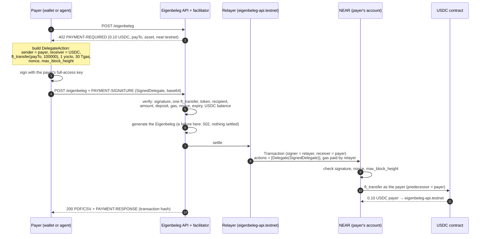

# Wallet delegate actions (NEP-366): who delegates what to whom

The x402 `exact` payment on NEAR is a **delegate action**, also called a meta
transaction ([NEP-366](https://github.com/near/NEPs/blob/master/neps/nep-0366.md)).
This page explains it for the Eigenbeleg API, for the agent and for a browser
wallet alike.

## In one sentence

The payer signs **one exact action** (one USDC `ft_transfer` of 0.10 USDC to
`eigenbeleg-api.testnet`) but does not send it; the API's **relayer** puts that
signed action into its own transaction and pays the gas. The action runs on
NEAR **as the payer**, so the USDC leaves the payer's account.

## What is delegated, and what is not

Delegated is **only the sending and the gas**. The relayer gets:

- the right to submit this one signed action, once (nonce), before a block
  height (`max_block_height`);
- the cost of doing so (gas, paid in NEAR by the relayer).

Not delegated:

- **no key, no account access.** The relayer cannot sign anything for the
  payer;
- **no change to the action.** Token, recipient, amount, deposit and gas are
  under the payer's signature. One byte changed and NEAR rejects it;
- **no second use.** The nonce is spent when it runs; after `max_block_height`
  it is void.

The relayer can only do two things: submit it as signed, or not submit it.

## The parties

| Role | On testnet | Does |
|---|---|---|
| Payer (`sender_id`) | the agent, or the person's wallet account | signs the delegate action; holds the USDC |
| Wallet / signer | the agent's local key, or Meteor, Intear, … in the browser | builds and signs the `DelegateAction` |
| API + facilitator | `POST /eigenbeleg` | asks for payment (402), checks the signed delegate, settles only after a successful run |
| Relayer | `eigenbeleg-api.testnet` (`RELAYER_ACCOUNT_ID`) | wraps the signed delegate into its own transaction, pays the gas |
| Token contract (`receiver_id`) | USDC, `3e2210e1…b8af` | executes `ft_transfer` |
| Recipient | `eigenbeleg-api.testnet` (`PAY_TO`) | receives 0.10 USDC |

## The flow



## What the payer signs

The object, nested (Borsh, then base64 in `PAYMENT-SIGNATURE`):

```
SignedDelegate
├─ delegate_action
│  ├─ sender_id:        eigenbeleg-agent.testnet        ← the payer
│  ├─ receiver_id:      3e2210e1…b8af                   ← USDC contract
│  ├─ actions:          [ FunctionCall
│  │                        method_name: ft_transfer
│  │                        args: { receiver_id: eigenbeleg-api.testnet, amount: "100000" }
│  │                        gas: 30 Tgas
│  │                        deposit: 1 yoctoNEAR ]
│  ├─ nonce:            access-key nonce + 1 (or higher)
│  ├─ max_block_height: current height + TTL
│  └─ public_key:       the payer's full-access key
└─ signature:           ed25519 over the NEP-461-prefixed hash of delegate_action
```

And what the relayer sends around it:

```
Transaction
├─ signer_id:   eigenbeleg-api.testnet   ← relayer, pays the gas
├─ receiver_id: eigenbeleg-agent.testnet ← the payer (NEP-366 rule)
└─ actions:     [ Delegate(SignedDelegate above) ]
```

The verified run on 6 Nov 2026 shows exactly this:
[`Aqxuj1QQ…ynUX`](https://testnet.nearblocks.io/txns/Aqxuj1QQ6zBRyjhxhF24ocb46Dwtag63cjd5TKD8ynUX).

## What the facilitator checks before it settles

From `@x402/near` (`exact` facilitator), all must hold:

- the signature is valid for `public_key`, and that key is a **full-access key**
  of `sender_id` (function-call keys are refused);
- exactly one action, a `FunctionCall` to `ft_transfer` on the asset in the
  402, to `payTo`, for exactly the amount, with 1 yoctoNEAR, at most 100 Tgas;
- the payer is not the relayer;
- `max_block_height` is in the future and **at most `maxTimeoutSeconds` blocks
  ahead** (about one block per second);
- the nonce is above the key's current nonce and in NEAR's allowed range;
- the payer holds enough USDC, and the recipient is registered with the token;
- the same signed delegate was not settled already.

## Agent and browser wallet: the same object, another signer

- **Agent** (`apps/agent/src/payer.js`): `createClientNearSigner` with a local
  key builds and signs the delegate itself. It picks `max_block_height` inside
  the window the 402 gives.
- **Browser wallet** (`apps/web/src/delegate.js`, [web-ui.md](web-ui.md)): the page asks the wallet
  through NEAR Connect, `wallet.signDelegateActions({ delegateActions: [{
  receiverId: <USDC>, actions: [ft_transfer …] }] })`. The **wallet** picks the
  nonce and `max_block_height` and shows the user what is signed. The page
  checks the returned `SignedDelegate` (one `ft_transfer`, token, recipient,
  amount) before it sends it.

Wallets differ in the TTL they choose. Meteor uses 200 blocks, more than the
120 s window the route allows today, so the browser flow needs a longer window
(now 300 s by default, `PAY_TIMEOUT_SECONDS`).

Wallets that declare `signDelegateActions` in the NEAR Connect manifest
(checked 2026-11-06): Meteor and Intear (testnet and mainnet), Ledger and
near-cli connect, HOT (mainnet only; its executor refuses testnet), NEAR Mobile
(mainnet only). Others, such as MyNearWallet, do not declare it.

## Risks, plainly

- **For the payer:** the worst case is losing the 0.10 USDC for nothing. The
  API settles only after the Eigenbeleg is made, and a failed settlement
  answers 402 without the files. But the relayer could submit and the response
  could be lost on the way: then the payer paid, and the transfer is on chain
  (search the payer's account on NearBlocks).
- **For the relayer:** it pays gas for every submitted delegate. The facilitator
  checks balance and expiry first, so a delegate that would fail is not sent.
- **Signing blind:** a wallet that shows only "sign delegate action" without
  the transfer details asks the user to trust the page. What Meteor and Intear
  show is to be checked when the UI is built; the page itself shows amount,
  token and recipient from the 402 before it asks.
